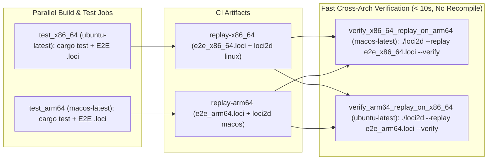

# Demand Spec: [Testing/CI] End-to-End (E2E) Test Suite and Cross-Architecture Validation for the Replay System (`.loci`)

**Issue:** [`Loci2D/loci2d#38`](https://github.com/Loci2D/loci2d/issues/38)  
**Status:** Ready to Implement  
**Reference ADRs:** [ADR-0006](../adr/en/0006-two-thread-network-gameloop-separation.md) · [ADR-0007](../adr/en/0007-deterministic-simulation-and-fixed-point.md) · [ADR-0010](../adr/en/0010-event-sourced-replay-format.md) · [ADR-0015](../adr/en/0015-dedicated-roadmap-structure-phase6.5-validation-dx.md) · [ADR-0021](../adr/en/0021-physical-projectiles-ccd-and-sensor-collisions.md)

---

## 1. Overview & Current Gaps

Currently, `loci2d` verifies replay determinism via in-memory integration tests (`tests/recording_integration_test.rs`, `tests/replay_determinism_test.rs`) and a standalone benchmark (`src/bin/benchmark.rs`). Meanwhile, `.github/workflows/ci.yml` executes `cargo test` independently on `ubuntu-latest` (`x86_64`) and `macos-latest` (`arm64`).

Two validation gaps remain before Phase 6.5 sign-off:

| Area | Current State | Gap |
|---|---|---|
| Production CLI Lifecycle | Tests construct `Instance` and `GameLoop` directly in Rust. | No automated E2E test spawns the compiled `loci2d` binary (`--record`, real UDP clients, graceful `stop` / `SIGINT` flush, and `--replay --verify`). |
| Cross-Architecture `.loci` Parity | `test_x86_64` and `test_arm64` only verify replays generated on the same host runner. | No CI step records a `.loci` file on `x86_64` and verifies it on `arm64` (and vice versa), leaving cross-CPU bit-exactness unproven in automated CI. |

---

## 2. Target Architecture & CI Pipeline

---

## 3. Detailed Design

### 3.1 Subprocess CLI E2E Integration Test (`tests/cli_e2e_replay_test.rs`)

1. **Compiled Binary Execution:**
   - Locate the server executable via Cargo's `env!("CARGO_BIN_EXE_loci2d")` without hardcoding `target/debug/loci2d`.
2. **Zero-Collision Ephemeral Port Binding:**
   - Launch the server subprocess with `BIND_ADDR=127.0.0.1:0` and `TICK_RATE=60` in its environment.
   - Pipe `stdout` and parse the `[Server] Bound to <addr>` log line (`src/main.rs:432`) to obtain the OS-assigned UDP port before sending client packets, avoiding `:8080` collisions in parallel test runs and eliminating arbitrary `sleep` waits.
3. **Multi-File VFS Map Validation (Issue #31 alignment):**
   - Generate a temporary modular map directory (`<tmp>/scripts/e2e_vfs_arena/`):
     - `main.lua`
     - `modules/movement.lua`
     - `modules/combat.lua`
   - Exercise sandboxed `require("modules.movement")` / `require("modules.combat")`, static obstacle spawning, player movement, projectile spawning/CCD, and custom properties.
   - Pass `--scripts-dir <tmp>/scripts --map e2e_vfs_arena --record <tmp>/match.loci --checkpoint-interval 10`.
4. **Real Multi-Client UDP Lifecycle:**
   - Bind 2 real `UdpSocket` clients (`Alice`, `Bob`).
   - Send `JoinIntent` (awaiting `"joined"` `ServerResponse`), `MoveIntent`, `ActionIntent` (spawning projectiles/combat state), and `DisconnectIntent` across at least 2 checkpoint intervals (`>= 25` ticks).
5. **Graceful Shutdown & Flush Coverage:**
   - **Cross-platform (`stop` command):** Write `"stop\n"` to child `stdin` (`spawn_console_listener` in `src/main.rs:93-121`), assert exit code `0`, and verify `<tmp>/match.loci` exists and is non-empty.
   - **Unix signal (`#[cfg(unix)]`, `SIGINT`):** Send `SIGINT` to the child PID (`ctrlc` handler in `src/main.rs:506-512`), assert exit code `0`, and verify the `.loci` file finalizes cleanly.
6. **Embedded VFS Self-Sufficiency & CLI `--verify`:**
   - Delete `<tmp>/scripts` before running verification so `loci2d --replay <tmp>/match.loci --verify` is forced to load the embedded `header.script_payload` VFS bundle (`src/main.rs:79-88`).
   - Assert exit code `0` and `✅` verification output.
   - If `LOCI_E2E_ARTIFACT_OUT` is set in the environment, copy the recorded `.loci` file to that path so CI can upload it directly.

### 3.2 Bidirectional Cross-Architecture CI Workflow (`.github/workflows/ci.yml`)

1. Keep `test_x86_64` (`ubuntu-latest`) and `test_arm64` (`macos-latest`) running in parallel, setting `LOCI_E2E_ARTIFACT_OUT` during `cargo test`.
2. Upload artifacts from each build/test job:
   - `replay-x86_64`: `e2e_x86_64.loci` and `target/debug/loci2d`
   - `replay-arm64`: `e2e_arm64.loci` and `target/debug/loci2d`
3. Add two lightweight verification jobs (`needs: [test_x86_64, test_arm64]`):
   - `verify_x86_64_replay_on_arm64` (`runs-on: macos-latest`): downloads `replay-x86_64` (for `.loci`) and `replay-arm64` (for `loci2d` binary), `chmod +x`, and runs `./loci2d --replay e2e_x86_64.loci --verify`.
   - `verify_arm64_replay_on_x86_64` (`runs-on: ubuntu-latest`): downloads `replay-arm64` (for `.loci`) and `replay-x86_64` (for `loci2d` binary), `chmod +x`, and runs `./loci2d --replay e2e_arm64.loci --verify`.

### 3.3 Documentation (`README.md` & `README.pt-BR.md`)

- Document the E2E CLI test and cross-architecture CI verification procedure under *"Deterministic Replay & Spectator System"*.

---

## 4. Implementation Checklist

- [ ] Add `tests/cli_e2e_replay_test.rs` covering `--record`, ephemeral `127.0.0.1:0`, multi-file VFS scripts, multi-client UDP intents, `stop` and `SIGINT` shutdowns, and `--replay --verify` without local script files.
- [ ] Update `.github/workflows/ci.yml` to export `.loci` + binary artifacts and run bidirectional `x86_64` ↔ `arm64` verification jobs.
- [ ] Document the E2E and cross-arch verification procedure in `README.md` and `README.pt-BR.md`.

---

## 5. Verification Plan

1. **Local E2E Execution:** Run `cargo test --test cli_e2e_replay_test` and confirm both `stop` and `SIGINT` (on Unix) E2E scenarios pass cleanly.
2. **Full Suite:** Run `cargo test` and verify 0 regressions.
3. **CI Validation:** Push PR and confirm `test_x86_64`, `test_arm64`, `verify_x86_64_replay_on_arm64`, and `verify_arm64_replay_on_x86_64` all pass green in GitHub Actions.
