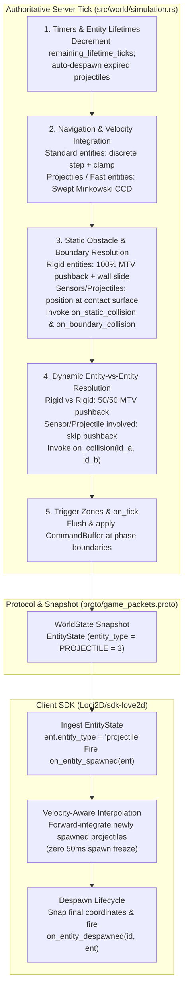

# Demand Spec: [CORE / SDK] Full Support for Physical Projectiles in `loci2d` and `sdk-love2d` Alignment

**Trello Card:** [`6fAvG98C`](https://trello.com/c/6fAvG98C) (Card #89)  
**Issues:** [`Loci2D/loci2d#43`](https://github.com/Loci2D/loci2d/issues/43) (complementing `#9`, `#10`, `#41`) · [`Loci2D/sdk-love2d#9`](https://github.com/Loci2D/sdk-love2d/issues/9)  
**Status:** Ready to Implement  
**Reference ADRs:** [ADR-0004](../adr/en/0004-packet-serialization-format.md) · [ADR-0005](../adr/en/0005-cross-language-binary-serialization.md) · [ADR-0007](../adr/en/0007-deterministic-simulation-and-fixed-point.md) · [ADR-0010](../adr/en/0010-event-sourced-replay-format.md) · [ADR-0012](../adr/en/0012-deterministic-2d-collision-and-kinematic-resolution.md) · [ADR-0014](../adr/en/0014-embedded-lua-scripting-and-command-buffer.md) · [ADR-0016](../adr/en/0016-data-driven-entity-properties-and-engine-agnosticism.md) · [ADR-0018](../adr/en/0018-client-sdks-and-network-abstraction.md) · [ADR-0020](../adr/en/0020-client-sdks-decoupling-and-extraction.md) · [ADR-0021](../adr/en/0021-physical-projectiles-ccd-and-sensor-collisions.md)

---

## 1. Overview & Problem Statement

To support multi-tick physical projectiles (such as skillshots, thrown weapons, fireballs, and ricocheting projectiles) that interact deterministically with players, static obstacles (`StaticObstacle`), and arena perimeters (`MapBounds`), both the Rust authoritative engine (`loci2d`) and the Love2D client SDK (`sdk-love2d`) require coordinated enhancements.

Currently, game scripts in `loci-arena` (e.g., `blade_throw.lua`) are forced to simulate projectiles via instant single-tick ray-sampling loops in Lua because of the following engine and SDK limitations:

| Component | Current State | Problem |
|---|---|---|
| `src/scripting/command.rs` | `Command::SpawnEntity` only matches `"Player"` and `"Enemy" \| "NPC"`. | Passing `entity_type = "Projectile"` logs a warning and falls back to `EntityType::Prop` with `CollisionFilter::default_player()` and an unused `NavigationComponent`. |
| `src/world/simulation.rs` (Dynamic Collisions) | `resolve_dynamic_collision` always applies a 50/50 MTV pushback to both colliding entities before calling `on_collision(id_a, id_b)`. | A projectile hitting a player physically shoves the player backward before Lua can process the impact. |
| `src/world/simulation.rs` (Static & Boundary) | Solid `StaticObstacle` and `MapBounds` silently push back / clamp the entity in Rust. | Lua is never notified when a projectile hits a wall or arena border, preventing wall-impact destruction, AoE explosions on walls, or normal-based ricochets. |
| `src/world/simulation.rs` (Integration & CCD) | Discrete position step ($\vec{p}_{t+1} = \vec{p}_t + \vec{v}$) without continuous sweep or built-in entity TTL. | High-speed projectiles ($\|\vec{v}\| > 2r$) tunnel straight through thin walls or players in a single tick. |
| `proto/game_packets.proto` | `enum EntityType` only defines `PLAYER = 0`, `NPC = 1`, `PROP = 2`. | Clients cannot natively distinguish projectiles from generic map props without string property workarounds. |
| `sdk-love2d` (`loci/init.lua` & `interpolation.lua`) | Remote interpolation holds newly spawned entities static until 2 snapshots bracket `render_time`; `on_entity_despawned(id)` only passes `id`. | Short-lived projectiles freeze for 50ms on spawn and discard their entity table/coordinates before client impact VFX/SFX can read their final position. |

---

## 2. Target Architecture & Simulation Flow



---

## 3. Detailed Changes in Core Engine (`Loci2D/loci2d`)

### 3.1 `proto/game_packets.proto` — Add `PROJECTILE = 3`

Extend `enum EntityType` with backward-compatible wire value `3`:

```protobuf
enum EntityType {
  PLAYER = 0;
  NPC = 1;
  PROP = 2;
  PROJECTILE = 3;
}
```

---

### 3.2 `src/world/entity.rs` — `EntityType::Projectile`, `is_sensor`, and `remaining_lifetime_ticks`

1. Add `Projectile` to `EntityType`:
   ```rust
   #[derive(Debug, Clone, Copy, PartialEq, Eq, Hash)]
   pub enum EntityType {
       Player,
       NPC,
       Prop,
       Projectile,
   }

   impl EntityType {
       pub fn as_u8(&self) -> u8 {
           match self {
               EntityType::Player => 0,
               EntityType::NPC => 1,
               EntityType::Prop => 2,
               EntityType::Projectile => 3,
           }
       }
   }
   ```
2. Extend `Entity` struct with `is_sensor` and `remaining_lifetime_ticks`:
   ```rust
   pub struct Entity {
       pub id: u64,
       pub name: String,
       pub position: DeterministicVector2,
       pub velocity: DeterministicVector2,
       pub entity_type: EntityType,
       pub collider: Option<ColliderShape>,
       pub collision_filter: CollisionFilter,
       pub navigation: Option<NavigationComponent>,
       pub properties: BTreeMap<String, String>,
       pub is_sensor: bool,
       pub remaining_lifetime_ticks: Option<u32>,
   }
   ```
3. In `Entity::new(id, name, entity_type)`:
   - Default `collision_filter` to `CollisionFilter::default_projectile()` when `entity_type == EntityType::Projectile`, else `CollisionFilter::default_player()`.
   - Default `is_sensor` to `matches!(entity_type, EntityType::Projectile)`.
   - Default `remaining_lifetime_ticks` to `None`.
   - Provide builder helpers: `with_sensor(mut self, is_sensor: bool) -> Self` and `with_lifetime_ticks(mut self, ticks: Option<u32>) -> Self`.

---

### 3.3 `src/scripting/command.rs` — Expand `SpawnEntity` & Add `SetSensor` / `SetLifetime`

1. Extend `Command::SpawnEntity` and add `SetSensor` and `SetLifetime`:
   ```rust
   SpawnEntity {
       entity_id: u64,
       blueprint: String,
       position: DeterministicVector2,
       velocity: Option<DeterministicVector2>,
       entity_type: String,
       move_speed: I16F16,
       radius: I16F16,
       is_sensor: Option<bool>,
       lifetime_ticks: Option<u32>,
       collision_layer: Option<u16>,
       collision_mask: Option<u16>,
       properties: std::collections::BTreeMap<String, String>,
   },
   SetSensor {
       entity_id: u64,
       is_sensor: bool,
   },
   SetLifetime {
       entity_id: u64,
       lifetime_ticks: Option<u32>,
   },
   ```
2. In `CommandBuffer::flush_and_apply`:
   - Match `"Projectile" | "projectile"` in `entity_type.as_str()` $\to$ `EntityType::Projectile`.
   - For `EntityType::Projectile`:
     - Use `CollisionFilter::default_projectile()` (unless overridden by `collision_layer` / `collision_mask`).
     - Set `entity.is_sensor = is_sensor.unwrap_or(true)`.
     - Do not attach `NavigationComponent` (projectiles are driven by linear velocity, not waypoint steering).
   - For `Player`, `NPC`, `Prop`:
     - Keep `CollisionFilter::default_player()` (unless overridden by `collision_layer` / `collision_mask`).
     - Set `entity.is_sensor = is_sensor.unwrap_or(false)`.
     - Attach `.with_default_navigation(move_speed, I16F16::from_num(1))`.
   - Apply `velocity` (if `Some(v)`) and `remaining_lifetime_ticks = lifetime_ticks`.

---

### 3.4 `src/scripting/api.rs` — Lua Bindings & Collision Layer Constants

1. **Update `Loci.Commands.spawn_entity(args)`**:
   - Accept optional fields from the `args` Lua table:
     - `velocity = { x = ..., y = ... }` (via `extract_vector2`)
     - `is_sensor = true | false`
     - `lifetime_ticks = N` (positive integer; `<= 0` treated as `None`)
     - `collision_layer = u16`, `collision_mask = u16`
2. **Add `Loci.Commands.set_sensor(entity_id, is_sensor)`** and **`Loci.Commands.set_lifetime(entity_id, ticks_or_nil)`**.
3. **Expose `Loci.Physics.Layer` constants table**:
   ```lua
   Loci.Physics.Layer = {
       NONE         = 0,
       SOLID_WALL   = 1, -- 1 << 0
       PLAYER       = 2, -- 1 << 1
       TRIGGER_ZONE = 4, -- 1 << 2
       PROJECTILE   = 8, -- 1 << 3
   }
   ```
4. **Update `Loci.get_entity(entity_id)`**:
   - Return `"Projectile"` for `EntityType::Projectile`.
   - Include `is_sensor` (`bool`) and `lifetime_ticks` (`u32` or `nil`) in the returned entity table.

---

### 3.5 `src/scripting/engine.rs` — Static & Boundary Collision Callbacks

Add two new callback dispatchers following the exact sandboxing, instruction-limit, and `with_scoped_api` patterns of `on_collision`:

1. **`on_static_collision`**:
   ```rust
   pub fn on_static_collision(
       &self,
       instance: &Instance,
       entity_id: u64,
       obstacle_id: u64,
       normal_x: f64,
       normal_y: f64,
       cmd_buffer: &mut CommandBuffer,
   ) -> LuaResult<()>
   ```
   Invokes global Lua `function on_static_collision(entity_id, obstacle_id, nx, ny)` if defined.

2. **`on_boundary_collision`**:
   ```rust
   pub fn on_boundary_collision(
       &self,
       instance: &Instance,
       entity_id: u64,
       normal_x: f64,
       normal_y: f64,
       cmd_buffer: &mut CommandBuffer,
   ) -> LuaResult<()>
   ```
   Invokes global Lua `function on_boundary_collision(entity_id, nx, ny)` if defined.

---

### 3.6 `src/world/physics/collision.rs` — Deterministic Swept-Circle CCD (Minkowski Sum)

To prevent high-velocity projectile tunneling while preserving 100% bit-exact fixed-point determinism ([ADR-0007](../adr/en/0007-deterministic-simulation-and-fixed-point.md), [ADR-0021](../adr/en/0021-physical-projectiles-ccd-and-sensor-collisions.md)):

1. **`swept_circle_vs_shape`**:
   - Given a moving circle with start center `origin`, displacement vector `delta`, and radius `radius`, and a target `ColliderShape`:
   - Compute `dist = deterministic_distance(DeterministicVector2::ZERO, delta)` and `dir = delta / dist`.
   - Expand the target shape by `radius` (Minkowski sum):
     - If target is `ColliderShape::Circle(c)`: test `ray_intersect_circle(origin, dir, dist, &DeterministicCircle::new(c.center, c.radius.saturating_add(radius)))`.
     - If target is `ColliderShape::AABB(aabb)`: test `ray_intersect_aabb(origin, dir, dist, &DeterministicAABB::new(DeterministicVector2::new(aabb.min.x.saturating_sub(radius), aabb.min.y.saturating_sub(radius)), DeterministicVector2::new(aabb.max.x.saturating_add(radius), aabb.max.y.saturating_add(radius))))`.
   - Returns `Option<(I16F16, DeterministicVector2)>` representing `(hit_t, contact_normal)` where `hit_t` is the travel distance along `dir` ($0 \le t_{\text{hit}} \le \text{dist}$) and `contact_normal` points outward from the target toward the moving circle.

2. **`swept_circle_vs_bounds`**:
   - Given `origin`, `delta`, `radius`, and `bounds: &MapBounds`:
   - Computes the shrunk valid center box `[bounds.min + radius, bounds.max - radius]`.
   - Evaluates the earliest slab exit `t_hit` along `delta` where the circle touches or crosses a boundary edge, returning `Option<(I16F16, DeterministicVector2)>` with the inward boundary normal (`(+1, 0)`, `(-1, 0)`, `(0, +1)`, or `(0, -1)`).

---

### 3.7 `src/world/simulation.rs` — Tick Pipeline Integration

Update `simulation::tick(instance, tick_count)` with the following deterministic stages:

1. **Stage 0 — Timers & Projectile Lifetimes**:
   - Alongside `active_timers`, iterate `instance.entities` in ascending `entity_id` order.
   - For each entity with `Some(ref mut ticks) = entity.remaining_lifetime_ticks`:
     - Decrement `*ticks = ticks.saturating_sub(1)`.
     - If `*ticks == 0`, collect `entity_id` into `expired_entity_ids` and remove after the loop.

2. **Stage 1 — Velocity Integration, Swept CCD & Map Bounds Detection**:
   - For standard non-projectile entities (`entity.entity_type != EntityType::Projectile`):
     - Advance `new_pos = old_pos.saturating_add(entity.velocity)` (preserving discrete MTV pushback and wall-sliding).
     - Clamp `clamped_pos = instance.map_bounds.clamp_shape(...)`.
     - If `clamped_pos != new_pos`, compute the inward boundary normal `(nx, ny)` from `(clamped_pos - new_pos)` and record a boundary collision event `(entity.id, normal)` to invoke `on_boundary_collision`.
   - For `EntityType::Projectile`:
     - First perform swept Minkowski CCD along `old_pos -> old_pos + velocity` against solid `StaticObstacle`s matching `collision_filter.can_collide(&obstacle.filter)` (in ascending `obstacle.id` order).
     - If a solid wall hit occurs prior to full displacement ($t_{\text{hit}} \le \|\vec{v}\|$), clamp the travel segment to the contact surface $\vec{p}_{\text{hit}} = \text{old\_pos} + \hat{d} \cdot t_{\text{hit}}$ and record the hit for `on_static_collision`.
     - Next, sweep the wall-clamped segment against all other collidable `Entity`s (`collision_filter.can_collide`) without snagging on teammates or piercing targets, recording every swept dynamic overlap for Stage 3 `on_collision` dispatch (walls behind the impact naturally occlude targets behind them).
     - Finally, clamp the resulting position against `instance.map_bounds` and record `on_boundary_collision` if clamped.

3. **Stage 2 — Static Solid Obstacle Collisions & `on_static_collision`**:
   - In ascending `obstacle.id` order, then ascending `entity.id` order:
   - If `intersect_shapes` (or swept CCD hit from Stage 1) reports collision:
     - If `!entity.is_sensor`: call `resolve_static_collision(&mut entity.position, &mut entity.velocity, &manifold)`.
     - If `entity.is_sensor`: push position out along `manifold.normal * manifold.penetration_depth` without zeroing/sliding `entity.velocity` (preserving velocity vector for Lua inspection or bounce reflection).
     - Invoke `instance.script_engine.on_static_collision(instance, entity_id, obstacle_id, normal_x, normal_y, &mut cmd_buffer)`.
   - Invoke `instance.script_engine.on_boundary_collision(instance, entity_id, normal_x, normal_y, &mut cmd_buffer)` for any entities that hit `MapBounds` in Stage 1.

4. **Stage 3 — Dynamic Entity-vs-Entity Collisions (Sensor vs. Rigid)**:
   - In ascending `(id_a, id_b)` pair order (`id_a < id_b`):
   - Skip if either entity was already destroyed or no longer exists.
   - If `manifold.is_colliding` (or swept CCD hit from Stage 1):
     - Check `let is_sensor_pair = instance.entities[&id_a].is_sensor || instance.entities[&id_b].is_sensor;`.
     - If `!is_sensor_pair`: apply `resolve_dynamic_collision(&mut pos_a, &mut vel_a, &mut pos_b, &mut vel_b, &manifold)` (50/50 pushback).
     - If `is_sensor_pair`: **do not apply `resolve_dynamic_collision`** (zero pushback on player/target).
     - Invoke `instance.script_engine.on_collision(instance, id_a, id_b, &mut cmd_buffer)`.

5. **Stage 4 & 5 — Trigger Zones, `on_tick`, and `cmd_buffer.flush_and_apply(instance)`**:
   - Flush and apply the command buffer deterministically after collision & tick callbacks.

---

### 3.8 `src/world/instance.rs` & `src/replay/hash.rs` — Snapshot & Replay Hash

1. In `Instance::create_snapshot` (`src/world/instance.rs`):
   ```rust
   entity_type: match e.entity_type {
       EntityType::Player => ProtoEntityType::Player as i32,
       EntityType::NPC => ProtoEntityType::Npc as i32,
       EntityType::Prop => ProtoEntityType::Prop as i32,
       EntityType::Projectile => ProtoEntityType::Projectile as i32,
   },
   ```
2. In `compute_canonical_state_hash` (`src/replay/hash.rs`):
   - Inside the entity loop, `entity.entity_type.as_u8()` already hashes `3` for `Projectile`.
   - To preserve 100% backward compatibility with existing `.loci` files (`benchmark.loci`), conditionally hash non-default sensor and lifetime state:
     ```rust
     if entity.is_sensor {
         hasher.update([0x5E]);
     }
     if let Some(ticks) = entity.remaining_lifetime_ticks {
         hasher.update([0x4C]);
         hasher.update(ticks.to_be_bytes());
     }
     ```

---

## 4. Detailed Changes in Client SDK (`Loci2D/sdk-love2d`)

### 4.1 Schema Synchronization (`lib/game_packets.proto` & `lib/game_packets.pb`)

Run `./tools/sync_sdk_proto.sh` from `loci2d` to propagate `EntityType::PROJECTILE = 3` and regenerate `lib/game_packets.pb`.

---

### 4.2 `loci/entity.lua` — Entity Type Mapping & Projectile Queries

1. Map Protobuf `entity_type` (numeric `0..3` or enum string `"PLAYER" | "NPC" | "PROP" | "PROJECTILE"`) to normalized lowercase strings:
   - `0` / `"PLAYER"` $\to$ `"player"`
   - `1` / `"NPC"` $\to$ `"npc"`
   - `2` / `"PROP"` $\to$ `"prop"`
   - `3` / `"PROJECTILE"` $\to$ `"projectile"`
2. Store `ent.entity_type` in `entity_module.new_entity(id, blueprint, entity_type)`.
3. Add methods on `Entity` metatable:
   - `Entity:is_projectile()` $\to$ `return self.entity_type == "projectile"`
   - `Entity:is_player()` $\to$ `return self.entity_type == "player"`
   - `Entity:is_npc()` $\to$ `return self.entity_type == "npc"`
   - `Entity:is_prop()` $\to$ `return self.entity_type == "prop"`
4. Add collection query helpers:
   - `entity_module.get_projectiles(ctx)` / `loci.get_projectiles()`
   - `entity_module.get_entities_by_type(ctx, entity_type)` / `loci.get_entities_by_type(entity_type)`

---

### 4.3 `loci/netcode/interpolation.lua` — Smooth Short-Lived Projectile Interpolation

Solve the 50ms initial spawn freeze and velocity snap issues for fast projectiles:

1. **Forward Integration on First Snapshot (`p1 == nil and p2 ~= nil`)**:
   - When `render_time` lies between `s1` and `s2`, and an entity was newly spawned in `s2` (`p1 == nil and p2 ~= nil`):
   - Previously, the entity sat frozen at `(p2.x, p2.y)` until `render_time >= s2.receive_time`.
   - Now, if `p2.vx ~= 0 or p2.vy ~= 0`, smoothly interpolate/integrate using its authoritative velocity relative to `(render_time - s1.receive_time)` (or from its spawn receive timestamp `_spawn_time`), so projectiles start moving across the screen on the very first frame they arrive!
2. **Pre-Window Newly Spawned Entities (`p1 == nil and p2 == nil`)**:
   - If the entity was just spawned in the newest buffered snapshot (`buffer[buf_len]`) and `render_time` is still bracketed by two older snapshots (`s1, s2`) where the entity did not exist yet, extrapolate forward from the spawn snapshot using `elapsed = math.max(0, now - entity._spawn_time)` and `(server_vx * tick_rate, server_vy * tick_rate)` so there is zero visual delay on projectile creation.

---

### 4.4 `loci/init.lua` — Despawn Callback Enrichment

In `loci._handle_world_state(state)`:
1. Pass `raw_ent.entity_type` when creating/updating entities and record `ent._spawn_time = now` on `is_new`.
2. When an entity is absent from `new_entities` (despawned):
   - Snap `ent.x = ent.server_x or ent.x` and `ent.y = ent.server_y or ent.y` so the entity reflects its latest authoritative coordinates.
   - Invoke `loci.on_entity_despawned(id, ent)` passing the `ent` table as the second argument before clearing `loci.entities[id] = nil` (100% backward-compatible with `function(id)`).

---

## 5. Sequential Implementation Plan

### Phase 1: Architecture & Specification (`loci2d`)
1. Commit `ADR-0021` in English (`docs/adr/en/0021-physical-projectiles-ccd-and-sensor-collisions.md`) and Portuguese (`docs/adr/pt/0021-projeteis-fisicos-ccd-e-colisoes-sensoras.md`).
2. Commit this Demand Specification (`docs/demand-specs/issue-43-physical-projectiles-spec.md`).

### Phase 2: Protocol, Entity Model & Command Buffer (`loci2d`)
1. Update `proto/game_packets.proto` with `PROJECTILE = 3`.
2. Update `src/world/entity.rs` (`EntityType::Projectile`, `is_sensor`, `remaining_lifetime_ticks`).
3. Update `src/scripting/command.rs` and `src/scripting/api.rs` (`spawn_entity` options, `set_sensor`, `set_lifetime`, `Loci.Physics.Layer` constants).
4. Update `src/world/instance.rs` and `src/replay/hash.rs`.

### Phase 3: Swept CCD, Sensor Resolution & Collision Callbacks (`loci2d`)
1. Implement `swept_circle_vs_shape` and `swept_circle_vs_bounds` in `src/world/physics/collision.rs`.
2. Add `on_static_collision` and `on_boundary_collision` in `src/scripting/engine.rs`.
3. Update `src/world/simulation.rs` to run lifetime expiration, swept CCD, non-pushback sensor collisions, and static/boundary Lua callbacks.
4. Add unit and integration tests in `tests/lua_api_test.rs` and `tests/replay_determinism_test.rs`; verify `benchmark.loci --verify`.

### Phase 4: Client SDK Alignment (`sdk-love2d`)
1. Run `tools/sync_sdk_proto.sh` to update `lib/game_packets.proto` and `lib/game_packets.pb` in `sdk-love2d`.
2. Update `loci/entity.lua`, `loci/netcode/interpolation.lua`, and `loci/init.lua`.
3. Add projectile lifecycle, type-query, and interpolation tests to `test_sdk.lua`.
4. Update `AI_REFERENCE.md` and `docs/server_scripts.html`.

---

## 6. Implementation Checklist

- [x] **`docs/adr/en/0021-*` & `docs/adr/pt/0021-*`** — Document architectural decision for physical projectiles, swept CCD, and sensor resolution.
- [x] **`docs/demand-specs/issue-43-physical-projectiles-spec.md`** — Author full technical specification.
- [x] **`proto/game_packets.proto`** — Add `PROJECTILE = 3` to `enum EntityType`.
- [x] **`src/world/entity.rs`** — Add `EntityType::Projectile`, `is_sensor: bool`, and `remaining_lifetime_ticks: Option<u32>`.
- [x] **`src/scripting/command.rs`** — Recognize `"Projectile"` in `SpawnEntity`, support `velocity`, `is_sensor`, `lifetime_ticks`, `collision_layer`, `collision_mask`, and add `SetSensor` / `SetLifetime`.
- [x] **`src/scripting/api.rs`** — Bind new `spawn_entity` fields, `set_sensor`, `set_lifetime`, `Loci.Physics.Layer` constants, and update `get_entity`.
- [x] **`src/scripting/engine.rs`** — Add `on_static_collision(entity_id, obstacle_id, nx, ny)` and `on_boundary_collision(entity_id, nx, ny)`.
- [x] **`src/world/physics/collision.rs`** — Implement deterministic fixed-point `swept_circle_vs_shape`.
- [x] **`src/world/simulation.rs`** — Integrate lifetime countdown, swept CCD for projectiles, sensor non-pushback dynamic collisions, and static/boundary Lua callbacks.
- [x] **`src/world/instance.rs` & `src/replay/hash.rs`** — Serialize `ProtoEntityType::Projectile` and add tag-prefixed backwards-compatible replay hash entries.
- [x] **`sdk-love2d`** — Sync protobuf schema, expose `ent.entity_type` / `ent:is_projectile()` / `loci.get_projectiles()`, eliminate 50ms spawn freeze in `interpolation.lua`, and pass `(id, ent)` to `on_entity_despawned`.

---

## 7. Testing & Verification Criteria

1. **Projectile Spawn & Defaults (`tests/lua_api_test.rs`)**:
   - Spawning with `entity_type = "Projectile"` sets `EntityType::Projectile`, `CollisionFilter::default_projectile()`, `is_sensor = true`, and emits zero warnings.
2. **Sensor Non-Pushback (`tests/lua_api_test.rs`)**:
   - A moving projectile colliding with a stationary player triggers `on_collision(proj_id, player_id)` while leaving the player's position and velocity completely unchanged (zero 50/50 pushback).
3. **Static Obstacle & Boundary Impact Callbacks (`tests/lua_api_test.rs`)**:
   - A projectile hitting a solid wall triggers `on_static_collision(proj_id, wall_id, nx, ny)` with the accurate outward surface normal `(nx, ny)`, enabling both instant destruction (`destroy_entity`) and ricochet reflection.
   - A projectile reaching `MapBounds` triggers `on_boundary_collision(proj_id, nx, ny)`.
4. **High-Velocity Swept CCD Anti-Tunneling (`tests/lua_api_test.rs`)**:
   - A projectile with `radius = 1.0` and speed `40.0` units/tick (moving 40x its radius in a single tick) fired at a thin wall (`width = 2.0`) or player (`radius = 2.0`) placed 15 units away detects the exact impact within that tick instead of tunneling past it.
5. **Lifetime Expiration (`tests/lua_api_test.rs`)**:
   - A projectile spawned with `lifetime_ticks = 5` exists for 5 ticks and is automatically removed on tick 5.
6. **Determinism & Replay Verification (`tests/replay_determinism_test.rs` & `benchmark.loci`)**:
   - Identical projectile matches produce identical canonical SHA-256 hashes across runs.
   - Existing `cargo run -- --replay benchmark.loci --verify` passes with 100% bit-exact hash parity.
7. **Client SDK Tests (`sdk-love2d/test_sdk.lua`)**:
   - Verify `entity:is_projectile()`, `loci.get_projectiles()`, immediate first-frame interpolation without 50ms freeze, and `on_entity_despawned(id, entity)` receiving the entity table with final coordinates.

---

## 8. Out of Scope (Downstream Game Tasks in `loci-arena`)

| Feature | Repository | Notes |
|---|---|---|
| Refactoring `blade_throw.lua` / `fireball.lua` to use `spawn_entity({ entity_type = "Projectile" })` | `Loci2D/loci-arena` | Handled by gameplay team once `loci2d` and `sdk-love2d` releases are published (e.g., Card #100 / `0McI8gc3`). |
| Custom projectile sprite rendering & impact particle VFX | `Loci2D/loci-arena` | Consumes `on_entity_spawned` and `on_entity_despawned(id, ent)` in `client/main.lua`. |
